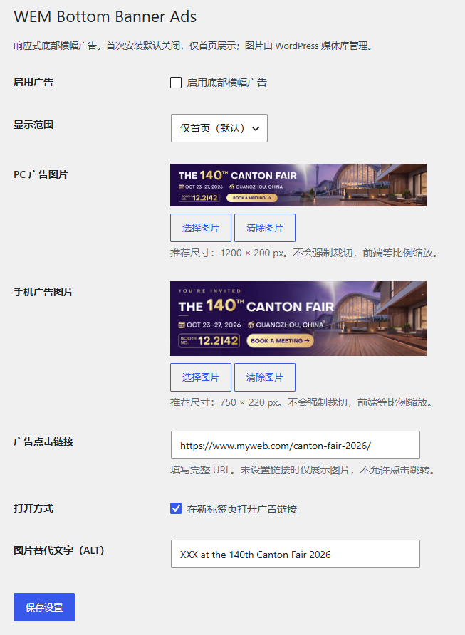

# WEM Bottom Banner Ads

轻量级 WordPress 响应式底部横幅广告插件，适用于企业官网的**展会宣传、活动推广、促销通知与临时公告**。通过 WordPress 后台管理广告图片和链接，无需反复修改主题文件。

**当前文档版本：v1.1.0** · **插件程序版本：v1.0.4** · [查看 Releases](https://github.com/coowinit/wem-bottom-banner-ads/releases)

> **版本说明：** v1.1.0 是此前的文档与截图整理版本；本次前端防闪现修复已将插件程序升级至 v1.0.4。仓库 Tag 与插件程序版本可能不同，安装时请以插件主文件中的版本号为准。

## 后台管理界面

插件安装并激活后，在 **插件 → 已安装插件 → WEM Bottom Banner Ads → 设置** 中即可进入管理界面；也可以通过 **设置 → WEM Banner Ads** 打开。



## 应用场景

- **展会活动**：宣传展会日期、展位号、参展邀请，点击进入活动专题页。
- **限时促销**：展示促销横幅，链接到指定产品或活动页面。
- **企业通知**：在首页公布重要消息，访客可自主关闭。
- **多站点复用**：插件不依赖具体 WordPress 主题，可在不同网站上复用。

该插件专为**单个底部悬浮横幅**设计，不是复杂的广告投放或统计平台。

## 核心功能

| 功能 | 说明 |
| --- | --- |
| 广告开关 | 首次安装默认**关闭**，不会自动向访客展示 |
| 展示范围 | 默认**仅首页**（`is_front_page()`）；可切换全站 |
| PC 图片 | 使用媒体库上传或选择，推荐 **1200 × 200px** |
| 手机图片 | 独立选择，推荐 **750 × 220px**；留空时沿用 PC 图片 |
| 响应式 | 640px 断点；最大宽度 1200px；按比例缩放、不强制裁切 |
| 点击链接 | 自定义完整 URL，可选新标签页打开；留空时只展示图片 |
| ALT 文本 | 可自定义图片替代文字 |
| 前端交互 | 底部滑入动画、关闭按钮、当前标签页会话记忆、防刷新闪现 |
| 设置入口 | 已安装插件列表提供「设置」快捷链接 |
| 前端依赖 | 无 jQuery、Bootstrap 或外部 CDN |

## 安装与使用

1. 从 [Releases](https://github.com/coowinit/wem-bottom-banner-ads/releases) 下载插件 ZIP。
2. WordPress 后台进入 **插件 → 安装插件 → 上传插件**，安装并激活。
3. 点击插件列表的 **设置**，上传 PC/手机图片并填写链接、ALT。
4. 确认展示范围，勾选「启用底部横幅广告」，保存设置。
5. 在首页检查电脑端、手机端的广告、跳转与关闭行为。

**注意：** 即使开启广告，若未选择有效 PC 图片，前端也不会输出空白广告。使用 WP Rocket、Cloudflare 或其他缓存时，修改配置后可能需要清理页面缓存。

### 图片准备建议

| 设备 | 推荐上传尺寸 | 前端处理 |
| --- | --- | --- |
| PC | 1200 × 200px（6:1） | 最大宽度 1200px，随容器等比例缩放 |
| Mobile | 750 × 220px（约 3.41:1） | 随屏幕宽度等比例缩放 |

建议提前制作好适配设备的 WebP/JPG 图片。推荐尺寸不是强制限制，插件不会重新裁切原图；上传带有大量文字的横幅时，请确认手机端文字仍可阅读。

### 关闭状态说明

访客点击关闭后，插件通过浏览器 `sessionStorage` 记录**当前标签页会话**中的关闭状态。更换图片/链接、切换展示范围或重新开启广告时，会刷新状态版本，使新广告能够再次展示。这不是跨设备、跨浏览器的永久记忆。前端广告默认不可见，JS 检查关闭状态后才显示，因此刷新页面时已关闭的广告不会短暂闪现；若 JavaScript 被禁用或被阻断，广告也不会显示。

## 文件结构

```text
wem-bottom-banner-ads/
├── wem-bottom-banner-ads.php       # 插件入口、默认值与设置快捷链接
├── includes/
│   ├── admin-settings.php         # Settings API、媒体库后台
│   └── frontend-banner.php        # 展示条件、前端广告 HTML
├── assets/
│   ├── css/banner.css             # 响应式、定位与动画
│   ├── js/banner.js               # 关闭与会话记忆
│   ├── js/admin.js                # 媒体库图片选择
│   └── images/close-button.svg
├── docs/
│   └── screenshots/
│       └── admin-settings.png    # 后台界面截图（文档资源）
├── README.md
└── LICENSE
```

## 技术与维护说明

- 使用 WordPress Settings API 和图片附件 ID 独立存储广告设置，避免依赖主题选项。
- 通过 `wp_footer` 输出广告；主题需要正确调用 `wp_head()` 和 `wp_footer()`。
- 图片使用 `<picture>` 响应式选择，前端 CSS、JS 和 SVG 独立管理。
- 对保存和输出的值进行必要的过滤与转义，例如 `absint()`、`esc_url()`、`esc_attr()`。
- 底部固定广告可能与 Cookie 弹窗、客服悬浮按钮、聊天窗口重叠；上线时务必检查。
- 会话关闭记忆依赖 `sessionStorage`；在某些隐私模式下不可用时，仍可临时关闭广告。
- 防闪现机制依赖前端 JS 将广告标记为 `is-ready`；需确保前端 JS 正常加载，并避免缓存/性能插件延迟该脚本（可能使广告迟显示或不显示）。
- 替换同一媒体附件的文件内容但不改变附件 ID 时，关闭记忆版本可能不会更新；如有需要，请重新上传并选取新附件。
- 如需修复代码，应同步增加插件主文件版本号与 `WEM_BBA_VERSION` 常量、更新变更记录并重新发布 ZIP；不要覆盖已经发布的版本 Tag 和 Release 安装包。
- 仅更改 README 或截图时，仓库版本可以单独记录，但不要将文档版本误写为程序版本。

## 维护原则与后续方向

**优先长期稳定，而非增加功能数量。** 本插件的定位是单条可关闭的悬浮广告。现阶段不计划加入多广告轮播、点击统计或复杂排期。只有实际需求出现后，再评估这些功能是否值得引入。

后续维护重点：WordPress/PHP 兼容性、移动端可访问性、缓存环境、关闭状态与页面渲染体验。

## 更新日志

### v1.0.4 — 修复关闭后刷新闪现
- CSS 默认隐藏广告，JavaScript 完成会话关闭状态检查后才添加 `is-ready` 显示广告。
- 已关闭广告在页面刷新时不再先显示后隐藏；保留原有会话记忆、滑入动画和后台设置。
- 同步更新插件头版本号和 `WEM_BBA_VERSION`，用于刷新前端资源缓存。

### v1.1.0 — 文档与截图完善
- 优化中文 README，补充使用场景、安装步骤、图片规范与维护建议。
- 新增并更新后台设置页面截图 `docs/screenshots/admin-settings.png`。
- **本次不涉及插件程序改动**；PHP 插件版本继续为 `1.0.3`。

### v1.0.3 — 当前稳定程序版本
- 修复广告关闭后，后台停用再启用仍可能保持隐藏的问题。
- 当启用状态或展示范围变化时，刷新前端关闭状态版本。
- 保留原有后台设置及广告图片。

### v1.0.2
- 在已安装插件列表中增加「设置」快捷链接。

### v1.0.1
- 修复设置页面重复显示 “Settings saved.” 的问题。

### v1.0.0
- 首次实现广告后台管理、PC/手机响应式图片、首页展示范围、滑入动画及关闭记忆。

## 许可

[MIT License](LICENSE)。
